### 👨‍💻 About Me

  <picture>
    <source media="(prefers-color-scheme: dark)" srcset="https://raw.githubusercontent.com/Aksar-S/Aksar-S/cards/about-dark.svg">
    
  </picture>
  <picture>
    <source media="(prefers-color-scheme: dark)" srcset="https://raw.githubusercontent.com/Aksar-S/Aksar-S/cards/streaks-dark.svg">
    
  </picture>

<!-- Optional: If you prefer Streaks in its own section paired with Weekly Rhythm or Languages:
### ⚡ GitHub Streaks & Activity

  <picture>
    <source media="(prefers-color-scheme: dark)" srcset="./images/streaks-dark.svg">
    
  </picture>
  <picture>
    <source media="(prefers-color-scheme: dark)" srcset="./images/weekly-dark.svg">
    
  </picture>

-->

 

---

<!-- 🐍 Snake Animation at the bottom -->

  <picture>
    <source media="(prefers-color-scheme: dark)" srcset="./images/github-snake-dark.svg" />
    <source media="(prefers-color-scheme: light)" srcset="./images/github-snake.svg" />
    
  </picture>

